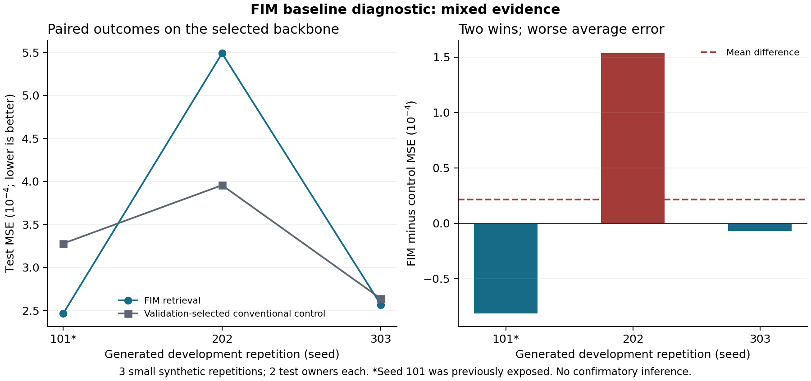

# FIM baseline development diagnostic — 19 November 2026

## Result and scope

**Mixed development evidence: retrieval won on two of three seeds but had worse average error than the validation-selected conventional controls.** Mean test MSE was 0.000350607695629 for FIM retrieval and 0.000328969673027 for the matched controls. The mean paired difference was **+0.000021638022602** (positive is worse), or **6.5775% worse** by the ratio of means. This small synthetic study does not establish broad efficacy, a novel mechanism, statistical significance, or conference readiness.

This is an opt-in diagnostic added to the maintained v2 implementation at `eb2ee3e7778cd408d49cb98baa33932c6419c03d`, on `olympus/fim-baseline-diagnostic-20261119`. The source is `successor/itfm_v2/src/fim_sota/baseline_diagnostic.py`. It addresses a concrete evidential defect: earlier maintained smoke comparisons lacked a training-fitted linear forecaster and matched finite-history residual estimators. The maintained tensor-memory and two-epoch MLP algorithms are unchanged. All pre-existing negative results and protected studies remain in place.

| Development seed | Validation-selected backbone | FIM test MSE | Validation-selected matched control | Control test MSE | FIM minus control |
| --- | --- | ---: | --- | ---: | ---: |
| 101 (previously exposed) | linear | 0.000246324202 | `linear--last_residual` | 0.000327782236 | -0.000081458034 |
| 202 | persistence | 0.000549012464 | `persistence--fifo_mean` | 0.000395576202 | +0.000153436262 |
| 303 | linear | 0.000256486420 | `linear--local_ridge--1` | 0.000263550581 | -0.000007064161 |

The predeclared conventional control selected across **all** backbones differs for seed 202: `linear--local_ridge--1`, MSE 0.000390253522294. Across the three seeds this secondary control mean is 0.000327195446324; FIM's mean is 7.1554% worse. This cross-backbone comparison is retained to avoid restricting conclusions to a weak selected backbone. All 81 test cells are in `analysis/all_test_cells.csv` and the raw archive; the displayed controls were selected from validation, never from test error.



## Fixed method and selection protocol

The three generated repetitions use seeds **101, 202, 303**. Seed 101 was exposed in earlier engineering work; all three are development data. Each repetition has disjoint training, validation and test owners (4/2/2), with chronological rolling forecasts. The three repetitions, rather than the correlated forecasting rows or the 81 cells, are the independent units used for this descriptive summary.

Three forecasters share each fixture: persistence; finite-history linear ridge fitted only on training owners; and the existing two-epoch MLP, with ten optimizer steps and 72 example presentations. Ridge minimizes sum squared error plus a coefficient penalty; the intercept is unpenalized. Its penalty is selected from 0.0001, 0.01 and 1 using validation error. The MLP budget is deliberately unchanged and does not constitute a tuned neural benchmark.

Each backbone is evaluated with no correction, last residual, FIFO residual mean, uniform top-k, an independently coded scalar cosine/softmax kernel, centered local ridge using the same penalty set, and the maintained `TensorMemoryBank`. This produces 27 cells per split and seed: **81 validation and 81 test cells**, not 81 independent repetitions. Alpha is selected from 0, 0.25, 0.5 and 1 on validation, with smaller alpha winning exact ties. The selected backbone minimizes uncorrected validation error; the matched conventional control minimizes corrected validation error within that backbone, excluding the memory and exact-kernel arms. The strongest conventional cross-backbone control is also selected on validation. Selection is written to disk before test batches are created or scored.

All residual donors must have the same owner, explicit target arrival no later than the query, and at least one event of age. Histories have a FIFO capacity of 16 per owner. Each prediction precedes insertion of its current target residual. Per-query outputs preserve base forecast, correction, target, donor IDs, donor times/arrivals, and solver/retrieval telemetry. The maximum observed maintained-memory/scalar-kernel correction discrepancy was 8.940696716308594e-08, below the fixed 5e-06 absolute tolerance. This agreement validates an implementation relationship; it is not evidence of a new estimator.

MSE is reduced equally across owners and then equally across seeds. Maintained backbone and correction tensors use FP32; ridge fitting, alpha combination, and scoring use FP64. The full immutable protocol is `protocol.json`; its SHA-256 is `1446775ae53a721f67f796339998736264fddbbfc6ca244dcaec28448f814323`. The complete package source manifest is `c3043378d764622bd08aefe91a4e07e99cccd149081fdbda3749df3ab4704e3b`.

## Execution and verification

One frozen run completed at `2026-11-19T10:32:05.539823+00:00`. It used **24.153 seconds wall time**, **14.525 process CPU seconds**, and **367,800,320 bytes peak RSS**. The predeclared caps were 300 seconds per seed, 1,200 seconds total, and one CPU thread. There were no outcome-driven changes or retries.

Before outcomes, 74 focused tests passed and one CUDA-only test was skipped, including 23 new tests for the diagnostic. Ruff and strict Mypy on the new module passed. An initial engineering attempt had two failures from treating `memory_bytes` as a method; these were fixed before any diagnostic outcome. Its original source and logs remain in `verification/`. `initial_tests.log` overlaps edits and is explicitly nonbinding; `final_tests.xml` is the test receipt.

A separate coordination agent reviewed source and protocol before execution, then independently recomputed selection, prediction arithmetic, owner-level metrics, donor chronology and 191 artifact hashes with a stdlib audit: **51,326 assertions, 2,916 validation-plus-test forecast rows, and 8,280 admitted donors**. Those receipts and its audit script are retained. The pre-outcome review preceded one metadata-only addition describing FP32/FP64 arithmetic; `verification/development_closeout_receipt.json` records both module hashes. The algorithm and tests did not change.

Saved-checkpoint/fixed-ridge replay exactly matched **81 test cells, 1,458 forecasts and 34,992 base/correction/target field values**, including donor/solver telemetry, in 3.305 seconds. It did not retrain the MLP or repeat model selection. These are separate-agent checks and same-host replay, not independent external reproduction.

## Reproduce from retained artifacts

The execution runtime was **Python 3.14.10, PyTorch 2.15.0+cpu, NumPy 2.5.5**, Linux x86_64. This is a prospectively recorded development overlay. The unchanged project's normal environment pins PyTorch 2.11.0 and NumPy 2.4.4; this study is not claimed as an execution under those older pins. Do not install the package editable with dependencies into the diagnostic overlay because that would replace the recorded versions.

From the repository root, extract the retained raw archive:

```bash
python3 -m zipfile -e research/development/baseline_diagnostic_20261119/raw_evidence.zip research/development/baseline_diagnostic_20261119
```

Create a separate environment using Python 3.14.10, then install the recorded runtime and test tools (the PyTorch CPU wheel comes from its official CPU index):

```bash
python3.14 -m venv /tmp/fim-diagnostic-env
/tmp/fim-diagnostic-env/bin/python -m pip install --index-url https://download.pytorch.org/whl/cpu torch==2.15.0+cpu
/tmp/fim-diagnostic-env/bin/python -m pip install numpy==2.5.5 pytest==9.2.0 ruff==0.17.5 mypy==2.4.1
cd successor/itfm_v2
export OMP_NUM_THREADS=1 MKL_NUM_THREADS=1 OPENBLAS_NUM_THREADS=1 PYTHONPATH=src
/tmp/fim-diagnostic-env/bin/python -m pytest tests/test_baseline_diagnostic.py tests/test_memory_causality.py tests/test_sota_memory.py tests/test_training_recovery.py
/tmp/fim-diagnostic-env/bin/python -m fim_sota.baseline_diagnostic --verify --output ../../research/development/baseline_diagnostic_20261119/run
/tmp/fim-diagnostic-env/bin/python scripts/replay_baseline_diagnostic.py --run ../../research/development/baseline_diagnostic_20261119/run --receipt /tmp/fim-replay-fresh.json
```

Replay requires the frozen source manifest to match. The independent scalar audit takes the run directory and a new receipt path:

```bash
/tmp/fim-diagnostic-env/bin/python ../../research/development/baseline_diagnostic_20261119/verification/independent_raw_audit.py ../../research/development/baseline_diagnostic_20261119/run /tmp/fim-independent-audit-fresh.json
```

A new execution, if deliberately wanted, must use a fresh output directory and preserves its own evidence:

```bash
/tmp/fim-diagnostic-env/bin/python -m fim_sota.baseline_diagnostic --output /tmp/fim-development-new-run
```

The command refuses existing output directories. No protected study, cloud training campaign, parameter sweep, or v3/v4 allowance is invoked. `scripts/plot_baseline_diagnostic.py` generates the static chart and analysis CSVs from saved results; plotting additionally requires Matplotlib and never changes study outputs.

## Boundaries and next scientific decision

This is only a small baseline diagnostic. It lacks public benchmark reproduction, a justified confirmatory sample size, a practical-effect threshold, robust tuned backbone comparisons, mechanism deletion/mispairing interventions, long-context unique-information evidence, and a cost/utility frontier. Per-query latency and tensor payload measurements are preserved but do not establish efficiency superiority. Local ridge and retrieval share bounded histories, while the persisted per-arm costs show their actual implementation overhead; no claim of identical compute is made.

The next defensible decision is whether a precise residual-information hypothesis remains worth testing after these mixed/worse-average results. A new public-data protocol would need fresh data identity/terms, fair baseline tuning budgets, temporal arrival rules, a practical margin, uncertainty at independent repetition level, and a separately approved execution budget. These development results cannot be promoted into protected confirmation. Original corrected 40-cell research remains held; the consumed v3 campaign and blocked/consumed v4 gates remain closed.

## Repository and workflow status

This scoped branch is based exactly on `eb2ee3e7778cd408d49cb98baa33932c6419c03d`. It adds the diagnostic, adversarial tests, saved-checkpoint replay, plot script and complete evidence, and appends a current-state receipt without altering prior outcomes. It does not change a historical algorithm, dependency pins, license decision, workflow or protected protocol. Ordinary push CI is a single standard public `ubuntu-24.04` CPU job; it checks formatting, lint, types, the maintained test directory, a static protocol audit and licenses. It has no matrix or explicit timeout (the hosted maximum is six hours). The protected trajectory workflow has no push trigger. The inherited license gate remains unresolved and must be reported from exact-head hosted checks; it has not been weakened.

The raw run is stored losslessly in `raw_evidence.zip` (2,803,142 bytes; SHA-256 `1238b4cf24ef690a3f3e925b1afedc39f748923345dd3efc42017c982be74abb`). Its 191 hashed payload artifacts plus manifest/verification retain all cells, raw generated data, selections, checkpoints and logs. `summary.json` and `protocol.json` are readable copies of their frozen run counterparts. `verification/CURRENT_RESEARCH_STATE_before.json` preserves the previous canonical state verbatim. The scoped package is a diagnostic dependency closure, not an archive of every FIM historical branch.
